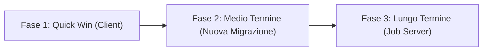

# Pwnify — Retention & Game Design Backlog

Documento operativo di analisi e pianificazione per le meccaniche di retention, progressione ed engagement etico dell'applicazione **Pwnify** (precedentemente ZeroDay).

---

## 1. Contesto Applicativo & Ipotesi Operative

- **Prodotto**: Pwnify — Piattaforma di addestramento pratico su cybersecurity, offensive security e networking (simulazioni PBQ, Flash Breach, sfide teorico-pratiche, radar delle competenze).
- **Utenti Attivi Settimanali (WAU)**: Test ristretto, stima indicativa < 50 utenti complessivi `[Ipotesi non consolidata]`.
- **Retention Attuale (D1 / D7 / D30)**: Non misurata formalmente in produzione; assenza di coorti storiche affidabili `[Dato non disponibile — da misurare prima/dopo]`.
- **Target Utenti**: Studenti universitari di discipline STEM, autodidatti entry-level, tecnici IT in fase di upskilling e junior security analyst `[Ipotesi]`.
- **Esami Obiettivo Attivi**:
  - **CompTIA Security+ (SY0-701)**: Mappato sugli obiettivi pubblicati ufficiali ([CompTIA Exam Objectives SY0-701](https://www.comptia.org/training/resources/exam-objectives)).
  - **Cisco CCNA (200-301)**: Mappato sugli obiettivi pubblicati ufficiali ([Cisco CCNA Exam Topics 200-301](https://learningnetwork.cisco.com/s/ccna-exam-topics)).
  - *Nota*: CEH e CompTIA Network+ risultano allo stato "in arrivo" e non sono considerati attivi.
- **Meccaniche Esistenti Considerate a Sistema**:
  - Streak server-authoritative con finestra di grazia (24h), scudo guadagnabile (`streak_shield_count`), congelamento ferie (`freeze_until_date`).
  - Flash Breach / 0xBreach con frequenza base del 10%.
  - Visualizzazione percentile di classe subordinata alla presenza di almeno 50 utenti (`percentile_50_min`).
  - Indice di preparazione basato sul Radar a 6 domini tecnici: *Web Sec*, *Networking*, *Linux & Bash*, *Cryptography*, *Code Analysis*, *Defense & SOC*.

---

## 2. Diagnosi Sintetica dei Punti Deboli

- **Craving Machine (Ricompense Variabili)**:
  La probabilità del Flash Breach (10%) non è dichiarata esplicitamente a schermo e l'assenza di un pity system rischia di causare frustrazione da serie negativa senza drop, mentre la frammentazione tra XP ed ELO disperde il senso di progresso.
- **Infinite Game (Loss Aversion & Assenza di Stati Finali)**:
  Completare i moduli target per un esame crea la percezione di "app finita" (done state), e la perdita accidentale dello streak non offre un percorso di recupero strutturato via challenge didattica autoritativa lato server.
- **Invisible Scoreboard (Confronto Sociale)**:
  La soglia protettiva di 50 utenti per il percentile azzera il feedback sociale nella fase di test ristretto, trasformando la dashboard in un report isolato senza opzioni leggere e asincrone di confronto tra pari.

---

## 3. Tabella Proposte Prioritarie

| Meccanismo | Feature | Impatto Atteso (Ipotesi) | Complessità | Rischio Etico & Mitigazione | Dipendenza Tecnica |
| :--- | :--- | :--- | :--- | :--- | :--- |
| **Craving Machine** | **Pity Counter & Drop Rate Trasparente per Flash Breach** Quota base (10%) dichiarata esplicitamente nell'UI con garanzia di sblocco forzato (pity drop) ogni 10 sfide consecutive senza drop. | **Medio** | Bassa | Rischio: Spinta compulsiva al "farming". Mitigazione: Limite giornaliero massimo a 2 Flash Breach e probabilità sempre visibili. | `client` (interfaccia) `nuova migrazione` (persistenza counter autoritativo su DB) |
| **Infinite Game** | **Indice di Preparazione a 6 Domini con 'Ultimo Ripasso'** Estensione dell'indice esistente senza alcun decadimento del punteggio numerico; aggiunta di label "Ultimo ripasso: X giorni fa" con suggerimento di ripasso mirato. | **Alto** | Bassa | Rischio: Ansia da punteggio calante. Mitigazione: Nessuna perdita di punti; solo reminder informativo orientato alla memoria a lungo termine. | `client` (calcolo intervallo da timestamp esercitazione) |
| **Infinite Game** | **Percorso Continuo Post-Esame & Cross-Bridge** Superati gli obiettivi d'esame, sblocco di scenari combinati e laboratori pratici senza "done state", mantenendo la progressione aperta. | **Alto** | Media | Rischio: Falso affidamento su certificazioni formali. Mitigazione: Esclusiva mappatura sugli obiettivi pubblicati; nessun claim di idoneità ufficiale o ore CPE/CEU. | `client` (albero scenari e catalogo) |
| **Infinite Game** | **Recupero Streak tramite Sfida di Ripasso Autoritativa** Possibilità di ripristinare uno streak perso entro 48h superando un quiz di ripasso rinforzato (`Remedial Gauntlet`). `[DA VERIFICARE]` | **Alto** | Media | Rischio: Banalizzazione dello streak o exploit client. Mitigazione: Convalida autoritativa lato server via RPC, max 1 recupero per mese solare. | `nuova migrazione` (RPC PostgreSQL dedicata per recovery streak) |
| **Invisible Scoreboard** | **Duello Asincrono via Parametro Seed Sanificato** Possibilità di condividere un link contenente `?seed=...` per confrontarsi sullo stesso set di quesiti a parità di condizioni. `[DA VERIFICARE]` | **Medio** | Media | Rischio: Tossicità da competizione e cheat su seed fisso. Mitigazione: Seed pseudocasuale orario, opt-out completo, punteggio espresso in accuratezza e tempo senza leaderboard globale forzata. | `client` (routing e validazione input tramite `sanitizeAlphanumeric`) |
| **Invisible Scoreboard** | **Hacker ID Card & Badge di Competenza per Dominio** Card sintetica condivisibile con il grafico radar dei 6 domini tecnici e data dell'ultimo ripasso. | **Basso** | Bassa | Rischio: Misleading su qualifiche professionali. Mitigazione: Chiara dicitura "Studio personale mappato su obiettivi pubblicati", nessun logo contraffatto. | `client` |
| **Piattaforma / Push** | **Schedulatore di Promemoria di Ripasso Asincrono** Job periodico per notificare l'utente quando uno o più dei 6 domini non riceve ripasso da oltre 14 giorni. | **Medio** | Alta | Rischio: Spam e churn da notifiche invasive. Mitigazione: Frequenza massima di 1 notifica ogni 7 giorni, opt-out configurabile nelle impostazioni. | `job server` (o cron esterno via Edge Functions) |

---

## 4. Percorso Post-Esame & Integrità delle Certificazioni

### 4.1 Mappatura Obiettivi d'Esame
Tutti i percorsi didattici e gli indici di preparazione devono utilizzare rigorosamente la dicitura:
> **"Mappato sugli obiettivi pubblicati"**

Non sono ammesse diciture che garantiscano il superamento dell'esame o percentuali arbitrarie di prontezza (es. "Pronto all'esame all'85%").
- Obiettivi CompTIA Security+ (SY0-701): https://www.comptia.org/training/resources/exam-objectives
- Argomenti d'Esame Cisco CCNA (200-301): https://learningnetwork.cisco.com/s/ccna-exam-topics

### 4.2 Divieto Assoluto di Claim CEU / CPE
Pwnify non è un provider accreditato e non emette crediti formativi formali. È severamente vietato promettere crediti CEU (CompTIA) o crediti Continuing Education (Cisco) né esporre badge che inducano a confondere l'appartenenza alla piattaforma con una certificazione emessa da enti terzi:
- Policy CompTIA Continuing Education (CEU): https://www.comptia.org/continuing-education/learners/how-to-renew
- Policy Cisco Continuing Education Program: https://www.comptia.org/certifications/security / https://www.cisco.com/c/en/us/training-events/training-certifications/training/continuing-education-program.html

### 4.3 Design dell'Infinite Game Post-Esame
1. **Ponti Cross-Domain**: Uno studente che completa gli obiettivi Security+ viene guidato verso scenari integrati con CCNA (es. Packet Analysis su switch Cisco e rilevamento di attacchi ARP/DHCP Spoofing).
2. **Weekly Incident Lab**: Sfida bisettimanale pratica basata su scenari simulati reali (senza scadenza punitiva).
3. **Mantenimento della Competenza**: L'obiettivo non è conservare un punteggio numerico, ma mantenere fresca la data dell'ultimo ripasso su ciascuno dei 6 domini.

---

## 5. Stato Verifiche Tecniche & Vincoli Architetturali

1. **Gestione del parametro `?seed=` `[DA VERIFICARE]`**:
   - `src/utils/security.ts` include `sanitizeAlphanumeric` per filtrare parametri URL.
   - `src/utils/multiplayerEngine.ts` genera sfide P2P partendo da un set condiviso.
   - *Verifica pendente*: La ricezione di un URL con parametro `?seed=` (es. `/challenge?seed=ABC123XYZ`) e la relativa ricostruzione istantanea del set di domande senza autenticazione P2P sincrona richiede un controller di routing dedicato lato client.
2. **RPC Server per Recupero Streak `[DA VERIFICARE]`**:
   - La migrazione esistente `20261024000001_server_validated_streak.sql` implementa `record_user_streak_activity` e la funzione one-shot `import_my_legacy_streak`.
   - Non esiste attualmente una procedura memorizzata `recover_lost_streak(p_token)`: qualsiasi logica di ripristino deve essere interamente server-side (SECURITY DEFINER con controlli su rate-limit e timestamp). È tassativamente escluso consentire al client di modificare direttamente `user_streaks.streak_days`.
3. **Job Server Indipendente**:
   - Qualsiasi funzionalità che dipenda da cron periodici centralizzati (es. invio push via FCM/WebPush o calcoli aggregati notturni) richiede un'infrastruttura di background dedicata (`job server` o worker esterno) attualmente non presente nell'architettura serverless Supabase del progetto. Deve essere trattata come specifica separata.

---

## 6. Roadmap Operativa in 3 Fasi

### Fase 1: Quick Win (Solo Client)
- Aggiunta della label `Ultimo ripasso: X giorni fa` sul Radar a 6 domini (nessun decadimento di punti).
- Esposizione esplicita della percentuale di drop Flash Breach (10%) e del contatore visivo del pity system.
- Formalizzazione dei link agli obiettivi pubblicati (SY0-701 e 200-301) e inserimento dei disclaimer etici.
- *Impatto su codice esistente*: Nessuna modifica al database, modifiche confinate a componenti UI.

### Fase 2: Medio Termine (Nuova Migrazione & Backend Supabase)
- Nuova migrazione SQL per tracciare il contatore del pity system in `user_streaks` o `user_profiles`.
- Implementazione RPC `recover_lost_streak` con vincolo di validazione della sessione didattica.
- Implementazione del generatore di duelli asincroni tramite query parameter `?seed=` sanificato.

### Fase 3: Lungo Termine (Job Server & Automazione Esterna)
- Implementazione di un worker di scheduling per notifiche di ripasso a bassa frequenza (max 1/settimana).
- Monitoraggio aggregato dell'engagement e coorti di utilizzo.

---

## 7. Framework di Misurazione Prima / Dopo (< 50 Utenti)

Dato il volume limitato di utenti attivi nella fase attuale (< 50 WAU), i test A/B standard non offrono significatività statistica e sono pertanto esclusi.

La validazione adotta una metodologia di confronto **Prima / Dopo** su finestre di osservazione di 14 giorni:

1. **Tasso di Ripasso Attivo**:
   - *Misura*: Numero medio di sessioni di ripasso avviate su domini con "Ultimo ripasso" > 7 giorni.
   - *Verifica*: Confronto tra la finestra pre-rilascio (label assente) e post-rilascio (label visibile).
2. **Utilizzo e Abbandono Post-Rottura Streak**:
   - *Misura*: Percentuale di utenti che riprendono l'attività entro 72 ore dopo una perdita di streak (prima e dopo l'introduzione della meccanica di recupero).
3. **Completamento Flash Breach**:
   - *Misura*: Frequenza di abbandono sessione durante i tentativi di Flash Breach prima e dopo l'esposizione trasparente delle probabilità e del pity counter.
4. **Micro-Feedback Qualitativo Non Invasivo**:
   - Singolo prompt in-app a comparsa unica al termine di una sessione di ripasso:
     > *"L'indicazione dell'ultimo ripasso ti è stata utile per organizzare lo studio?"* [Sì / No]
